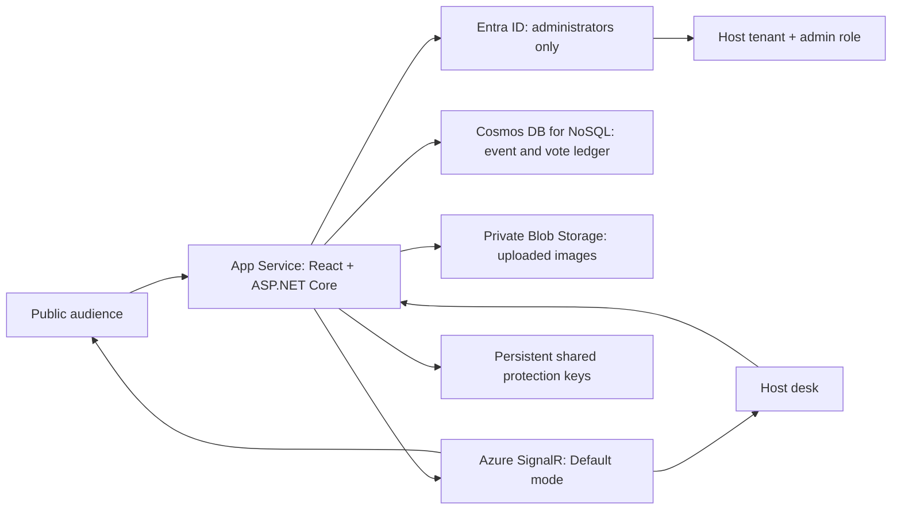

# Copilot Fireside Chat · Christmas edition

A runnable React + ASP.NET Core application for a live Christmas panel. The audience
sets a display name to view without signing in. **Reacting requires a self-registered
audience username and password**; the host desk requires Microsoft Entra, the host
tenant and an explicit application role. Designed for **Azure App Service**, not
Static Web Apps.

Azure infrastructure is defined in `infra\main.bicep`. Running the template creates
billable resources; review the target, capacity and cost before deploying. It does
not create an Entra application or migrate event data automatically.

## What it does

- Public audience page focused on a viewport-filling live discussion. Top tabs
  switch between Live, Questions & votes, and Panellists without leaving the page,
  with arrow/Home/End keyboard navigation. Short screens and long content scroll
  naturally; nothing is clipped to a fixed height.
- The compact header contains the demo notice, connection status and account
  controls. Question cards are read-only, with separate Total points and Your points
  boxes. Your points are the signed-in viewer's net +1/-1/+3 contribution, not an
  action count or a list of other participants. Only the Live view has voting controls;
  it does not display a points total. Counts remain in Questions, Scoreboard and the host desk.
- The default landing view uses a local copy of the user-selected December event
  poster. Hosts can upload a replacement PNG/JPEG and accessible description,
  restore the default, or select **Show landing page** to stop the discussion.
- Name-to-view participation with a protected HTTP-only display-name cookie.
  Names are not authentication and are not public. Viewing and SignalR remain
  anonymous; the voting API requires a separate, server-validated audience account.
- Three repeatable actions: **Like the point** adds 1, **Don't like this point**
  subtracts 1, and **EPIC POINT!** adds 3. Scores may be negative. Every accepted
  action is a durable ledger entry; a request UUID prevents retries from scoring
  or broadcasting twice, rather than restricting a person to one vote.
- Everyone connected sees the matching original bauble, mischievous elf or large
  present rise from the bottom and fade at roughly one-third viewport height.
  Reduced motion shows a brief stationary reaction instead. Reactions are transient,
  capped at 30 visible items per client, and never replayed after reconnecting.
- Host desk at `/admin`: create, edit, order, publish, hide and delete panellists and
  questions; select the current discussion; mark questions answered; pause voting;
  edit the event title and subtitle; manage the landing artwork. New questions and
  panellists are hidden by default.
- Hosts can upload a PNG/JPEG photo for each panellist and assign a speaker to each
  question. The Live view shows the selected published speaker and portrait,
  including on mobile. Hidden photos stay behind the admin API; deleting a
  panellist unassigns their questions without deleting those questions or votes.
- Each question has a **Select speaker** control and previous/next arrows. They
  cycle through published speakers, wrapping at either end. Selection updates the
  audience immediately and clears the previous clock; it **does not start a timer**.
  Use **Start speaker timer** when ready. Edit a question and use the up/down arrows
  under **Speaker order for this question** to save its own order. New panellists
  append to existing orders; hidden panellists are skipped, not exposed publicly.
- The collapsible **Speaker scores** section on the host desk starts closed to
  save space; its summary shows whether the audience scoreboard is visible.
  Expand it to see each speaker's points for each question
  and their total. New reactions are permanently credited to the published speaker
  active on that question when the server accepts them; switching speakers never
  moves earlier points. Historical unassigned reactions stay unassigned; new reactions
  require an active published speaker and running timer. Deleted speakers retain their historical attribution in
  the host desk as “Removed speaker”; their scores are not published to audiences.
- Hosts can edit a speaker/question total with a required reason. The server stores
  an additive adjustment with the actor's pseudonymous Entra key and server time,
  rather than rewriting individual votes. New reactions add to the adjusted total;
  personal contribution history remains based only on that person's reactions.
  Edits accept integer totals between -1,000,000,000 and 1,000,000,000.
- The audience **Scoreboard** tab starts hidden. **Show scoreboard / Hide scoreboard**
  applies to every audience connection live. Hidden snapshots omit scoreboard data
  server-side, not just its controls. Hiding it moves viewers back to Live. Published
  scoreboards contain only published questions and panellists.
  Speaker portraits appear alongside their names in totals and per-question rows,
  using the same uploaded photos as the live view.
- Shared timer lengths default to 120 seconds for speakers and 300 for group
  discussions, configurable from 5 to 3600 seconds. **Start speaker timer** selects
  that question and starts/restarts its assigned speaker's timer. **Start group
  discussion** selects it in an open-floor panel mode with its separate timer.
  This is a timed spoken discussion, **not an in-app text chat**.
- Timer start time and captured duration are stored on the server and pushed live.
  Reconnects recover the same deadline; local clock skew is compensated using server
  time. Editing central lengths affects subsequent starts only. Zero displays
  “Time's up” without advancing the question or changing mode. **Stop timer**
  clears the clock, not the discussion mode.
- Audience speaker and group clocks pulse and grow during their final 15% and show
  “Time running low”. Reduced-motion users get the same steady text/color warning
  without flashing. Host clocks remain steady; reaching zero stops the warning.
- Group discussions have no voting controls and the voting API rejects actions
  while group mode is active, even if the global voting switch is open or its
  timer has stopped/expired. Start a speaker timer or leave the discussion to exit
  group mode; the separate global pause remains respected.
- Speaker voting requires the current published question, published speaker and a
  running server timer. Stop/not-started/expired clocks reject new reactions, including
  at the exact deadline. Transaction retries recheck time. Retrying an already accepted
  request acknowledges that same action without adding points. The audience disables
  controls at the shared deadline without waiting for the next board refresh.
- Server-enforced host tenant plus admin role, CSRF protection, secure production cookies, same-origin
  APIs, validated input, rate-limited participation and revision-checked host edits.
- SignalR invalidations after committed writes; clients refetch a filtered snapshot
  on notification, reconnect, tab wake-up and every 15 seconds. Hidden material never
  leaves the admin API. The public hub has no client-callable publishing methods.
- SQL transactions and a reaction-request primary key prevent duplicate retries.
  Stale host edits and database contention return a visible retry/conflict response.
- Production starts only with real administrator Entra, Cosmos and Azure SignalR configuration.
  There is no production anonymous-admin shortcut.

## Run the local sample event

Prerequisites: **.NET 10 SDK**, **Node.js 22.12+** and npm. No Azure login is needed.
Commands below run from the repository root in PowerShell.

```powershell
npm ci --prefix .\client
npm run build --prefix .\client
dotnet run --project .\server\Fireside.csproj --launch-profile Demo -- --initialize-database --seed-demo
dotnet run --project .\server\Fireside.csproj --launch-profile Demo
```

Open http://127.0.0.1:5180 and http://127.0.0.1:5180/admin in separate browser
contexts. Set an audience name, then choose **New here? Register** to create a real
local audience account. Viewing without that step works; reaction buttons remain disabled. Choose
**Enter demo host desk** on the admin page. Publish a question, discuss it and vote
from the audience window after starting a speaker timer. Sign into the same audience
account in another browser to retain its personal contribution history.

The explicit `Demo` launch profile sets Development, uses local SQLite and enables
the labelled local host shortcut only. Audience registration uses the same password
and cookie flow as production. Demo startup is rejected outside Development or
when the Azure App Service `WEBSITE_INSTANCE_ID` environment variable is present.
The sample speakers are fictional placeholders, not confirmed guests. Samples are
seeded only with `--seed-demo` into an empty database. Re-running initialization does
not overwrite an existing event.

Local data and protection keys live under `server\.data` and are git-ignored.
Don't delete that directory if you want to retain cookies, vote records and content.
An event without sample data can be initialized with `--initialize-database` alone.

For frontend hot reload, leave the ASP.NET server running and, in another terminal:

```powershell
npm run dev --prefix .\client
```

Vite proxies `/api`, `/auth` and `/live` to port 5180. Use the same browser origin
throughout a session. Use the built application, not Vite, for real Entra sign-in.

## Validate

```powershell
dotnet test .\tests\Fireside.Tests.csproj
npm test --prefix .\client
npm run build --prefix .\client
# With the local Demo server running:
npm exec --prefix .\client -- playwright install chromium
npm run test:e2e --prefix .\client
# Produces one deployable application, including the React build:
dotnet publish .\server\Fireside.csproj -c Release -o .\server\bin\publish
```

Server integration tests exercise host-tenant/role restrictions, anonymous/forged
participant identities, malformed/personal identity rejection, cross-tenant voting,
CSRF enforcement, idempotent concurrent requests, repeated +1/-1/+3 actions, negative scores,
per-identity rate limits, hidden content, revision conflicts, voting eligibility,
image upload bounds/permissions/persistence, hidden portrait protection, speaker
assignment/deletion, authoritative timer recovery, group-mode voting rejection,
deletion cascades, live hub reactions,
and production demo rejection. React tests cover reaction eligibility and safe text
rendering. Desktop and mobile Playwright scenarios use independent audience/host
contexts to exercise public reading, explicit voter sign-in, moderation, voting,
repeatable scoring, matching reactions in independent browsers, reduced motion,
one-third-height animation end state, image upload/reset, keyboard tabs, viewport
fit, voter denial at the host desk, speaker photo uploads/selection, separate
speaker/group clocks, direct group-mode vote rejection and reconnect recovery.
Scoreboard checks cover cast-time attribution, audited adjustments, untouched
personal histories, hidden-data filtering, the one-time reset guard, collapsible
host controls, portrait rendering, and live show/hide across independent viewers.
Browser scenarios modify the demo event. Use a disposable local database rather
than an event someone is using. Set `FIRESIDE_BASE_URL` to target an isolated
instance (for example `http://127.0.0.1:5190`); the default remains port 5180.
Browser tests add and clean up their own clearly named sample content; run them
against a development event only.

## Proposed Azure architecture



React is served by the same ASP.NET application as the API and hub, avoiding
cross-origin cookie and authentication configuration. Azure SignalR fans out a
data-free change event; browsers then fetch their own permitted projection.
Transient reaction messages contain only the request ID, question ID and action
kind, never the voter's identity or name.
Personal point totals are derived server-side from the authenticated audience account
and returned only in that viewer's uncached board response; anonymous viewers receive
no personal total. They are never included in public hub messages.
Cosmos DB for NoSQL is mandatory outside local development/tests: local SQLite
must not be put on App Service ephemeral storage or used for scaled-out production.
The native Cosmos SDK uses one event partition (`/eventId`): an event-core document
holds metadata, image references and score projections, while immutable vote and
adjustment documents and per-voter totals are separate. A transactional batch
conditionally replaces the core using its ETag and creates the ledger/personal
updates together. Retries recheck the active speaker, group-mode voting restriction
and host revision; duplicate reaction IDs do not replay reactions or points.
Votes change the internal ETag but not the host-facing revision.
The account must use **Strong consistency**, also requested by the client, so an
invalidation received on another App Service instance cannot fetch an older snapshot.
Personal totals are read with a core ETag recheck for a coherent combined response.

Single-region Serverless suits an intermittent event, but RU consumption must be
measured before opening to the full audience. Strong reads cost more RUs, and all
event writes contend on one core document. This intentionally targets a small live
panel, not an unbounded high-write multi-event platform. Cosmos limits each item
and transactional request to 2 MB, each batch to 100 operations and each logical
partition to 20 GB. Images never enter core documents; oversized metadata is rejected
without committing a partial change. Configure monitoring for throttling, latency,
document/partition size and spend; client conflicts are explicit and retryable.

Audience registration uses private account documents in the existing Cosmos event
partition (a separate table in local SQLite), never the public board/SignalR payload.
Case-insensitive ASCII usernames use deterministic hashed document keys so concurrent
registrations cannot create duplicates. Passwords are salted and hashed by ASP.NET Core
Identity's PBKDF2 PasswordHasher (IdentityV3, 210,000 iterations), not custom cryptography.
Passwords/passphrases must be 15-128 characters; usernames are 3-32 letters, numbers,
dots, underscores or hyphens. No email, password recovery or account-linking service
is provided. Anyone may create multiple accounts: this is not proof of one human.

The independent audience cookie is HTTP-only, HTTPS-only in production, SameSite Lax,
non-sliding and limited to two hours. Each request validates its account ID/security
stamp against durable storage. Registration, login and logout require CSRF protection.
Account bodies are capped at 4096 bytes, hashing concurrency is bounded, and registration/
login share a 30-request/minute/IP/instance limit. Five failed logins atomically lock
an account for 15 minutes across instances; successful login resets the counter.
Existing signed-in sessions are not revoked by someone else's failed login attempts.

New accounts receive random immutable voter IDs, with no transfer of old Entra voting
history, even if names match. Existing votes, personal totals, adjustments and event
settings are untouched. Back up account documents with event data; the initial SQLite
event importer deliberately refuses a source containing accounts rather than losing them.
No new Azure resource or service tier is required; account reads/writes consume the
existing Cosmos allowance and password hashing uses existing App Service CPU.

Host management requires the configured administrative tenant **and** `Fireside.Admin`.
An external tenant assigning that role to its own user cannot grant host access.
Host-desk sign-in uses a separate, tenant-specific OIDC scheme so guest hosts
authenticate in the host directory, not accidentally in their home directory.
External hosts can be invited as B2B guests in the host tenant and assigned the role
there. The application stores no email addresses or raw Entra IDs in vote records;
the stable hash remains pseudonymous personal data requiring an event retention policy.

## Real Entra administrator sign-in

After approval, an Entra administrator must:

1. Select the administrative tenant and create a **multitenant Web application**
   registration, supported account type **Accounts in any organisational directory**.
   Register `https://<event-host>/signin-oidc-admin` as a Web redirect URI and
   `https://<event-host>/signout-callback-oidc-admin` as a signed-out callback.
   For local Entra testing, also register `https://localhost:7180/signin-oidc-admin`
   and `https://localhost:7180/signout-callback-oidc-admin`. Existing unused audience
   callback registrations can remain; the application no longer uses audience Entra.
2. Add an app role with **value `Fireside.Admin`**, allowed member type **Users/Groups**,
   enabled. Assign only the intended host users/groups to it in Enterprise
   applications in the host tenant. Audience accounts are independent of this registration.
   Merely signing in or being an Entra directory administrator does not grant access.
3. Configure the tenant ID, client ID and a client secret outside source control.
   The confidential server performs OIDC authorization code + PKCE; the browser
   receives only an encrypted application cookie, not tokens or the client secret.
   The standard `openid` / `profile` scopes are sufficient: this application does
   not call Microsoft Graph and needs no directory-wide API permissions.

For local real-auth testing, use environment variables (or your secret manager) and
the `Entra` launch profile:

```powershell
# Set AzureAd__TenantId, AzureAd__ClientId and AzureAd__ClientSecret securely first.
dotnet dev-certs https --trust
dotnet run --project .\server\Fireside.csproj --launch-profile Entra -- --initialize-database
dotnet run --project .\server\Fireside.csproj --launch-profile Entra
```

No values for a real tenant or secret are present in this repository. Never paste
secrets into commands that will be committed, support transcripts or browser code.
Authentication sessions expire after two hours; removing a host role takes effect on the next
sign-in/expiry, not by immediately revoking an already-issued app cookie.

## App Service configuration handoff — not deployment authorization

Agree the subscription, region, resource names, capacity, budget, domain and admin
tenant before any infrastructure scaffold. Approve a separate deployment step before
creating or modifying billable resources.

### Bicep deployment

`infra\main.bicep` is a subscription-scope entry point with modules for Linux B1
App Service, Cosmos DB for NoSQL Serverless/Strong consistency, private Hot LRS
Blob Storage, SignalR Standard S1, Key Vault, and linked monitoring. It creates
managed-identity permissions, persistent cookie-key configuration and server-only
telemetry settings. The reviewed resource names use the `fireside-prod-5fa8`
suffix; review every name before reusing this template for a different event.
This is a single-instance/single-region baseline with public HTTPS service endpoints,
not private networking or a zone-redundant design.

The parameter examples deliberately contain placeholders. Supply real metadata in
a local ignored parameter file, never credentials. The deployment principal needs
permission to create resources and assign roles in the selected subscription.
Check that the intended Azure CLI account belongs to the intended tenant; commands
below explicitly select the subscription without changing shared CLI defaults.

```powershell
$subscriptionId = '<subscription-guid>'
$parametersFile = '<absolute-path-to-local-metadata.parameters.json>'

az deployment sub what-if --subscription $subscriptionId --location swedencentral `
  --template-file .\infra\main.bicep --parameters "@$parametersFile"

# Only after reviewing the what-if and approving provisioning:
az deployment sub create --subscription $subscriptionId --location swedencentral `
  --template-file .\infra\main.bicep --parameters "@$parametersFile"
```

Before deploying application code, create/configure the dedicated multitenant
Entra Web registration and host role described above. Use the template's actual
`appServiceHostname` output for redirect URIs, not an assumed hostname. Using the
operator's Key Vault data access, store the registration's client ID and returned
client secret directly as `entra-client-id` and `entra-client-secret`. Transfer
the credential to Key Vault entirely in memory; do not put it in CLI arguments,
parameter files, transcripts or environment files. This explicit post-provisioning
step avoids needing credentials before the vault exists. SignalR and monitoring
connection secrets are created by Bicep; Entra references deliberately remain
unresolved until registration setup. Verify every Key Vault reference resolves
before publishing the application.

Build the published application as described above, then upload that ZIP with
`az webapp deploy --subscription <subscription-guid> --resource-group <group> --name
<app> --type zip --src-path <published-zip>`. The template temporarily enables SCM
basic publishing for this deployment lifecycle; disable and verify it after
upload, including failure cleanup. FTP remains disabled. Import and verify the
existing event using the cutover procedure below; no startup seeding occurs.

| App setting | Required value / decision |
|---|---|
| `ASPNETCORE_ENVIRONMENT` | `Production` |
| `Demo__Enabled` | `false` (never deploy the Demo launch profile) |
| `AllowedHosts` | Exact public App Service/custom host names, semicolon-separated |
| `Database__Provider` | `Cosmos` |
| `Cosmos__Endpoint` | HTTPS Cosmos DB for NoSQL account endpoint |
| `Cosmos__Database` | Existing database name |
| `Cosmos__Container` | Existing container partitioned by `/eventId`, with no TTL that expires active data |
| `Cosmos__EventId` | Stable, nonempty partition identifier for this event |
| `Storage__BlobServiceUri` | HTTPS Blob service URI; anonymous blob access disabled |
| `Storage__Container` | Existing private image container |
| `ConnectionStrings__AzureSignalR` | Azure SignalR connection string, kept in App Service/Key Vault configuration; service **Default** mode, never Serverless |
| `AzureAd__TenantId` | Administrative directory tenant GUID |
| `AzureAd__ClientId` | Web application client GUID |
| `AzureAd__ClientSecret` | Key Vault reference/App Service secret setting, with an agreed rotation owner |
| `DataProtection__KeyPath` | Persistent shared writable path outside the deployment package (Linux App Service: `/home/fireside-keys`; Windows: a dedicated directory under `D:\home`) |
| `ASPNETCORE_FORWARDEDHEADERS_ENABLED` | `true` behind the trusted App Service ingress only; leave unset when directly hosting Kestrel |

Use the App Service .NET 10 runtime, HTTPS Only, Always On and WebSockets. Linux
startup command: `dotnet Fireside.dll`. Run the published output from its directory.
Keep app-level anonymous access enabled: the application itself protects admins,
while audience pages and SignalR negotiation must remain public. Don't enable
platform-wide mandatory Easy Auth, which would block the requested public audience.

App Service's ingress must be the only path to Kestrel and must sanitize forwarded
headers. The forwarded-header setting is appropriate for that controlled topology,
not an untrusted general-purpose reverse proxy. Verify HTTPS callback URLs and secure
cookies through the real ingress before opening the event.

Persist and restrict access to the Data Protection key ring: losing it invalidates
admin and participant cookies. It must be shared by all instances serving the same
event, and treated as secret key material. App Service storage encryption/permissions
protect the baseline file-based key ring; use a Blob/Key Vault-protected key ring if
the deployment's security policy requires application-level key encryption. Plan
slot/key sharing before using deployment slots. Back up Cosmos and Blob independently
of the application, and rehearse a coordinated restore of metadata and media.

The runtime uses its **system-assigned managed identity**, not a developer credential
fallback or account key. Grant Cosmos DB Built-in Data Contributor scoped to the
event container and Storage Blob Data Contributor scoped to its private container.
Configure Cosmos account consistency as Strong; a client cannot strengthen a weaker
account setting. Disable Cosmos local-key auth and Storage anonymous blob access.
Private container access does not imply a private network endpoint: select the
network/firewall topology at the infrastructure approval gate. Images are served
through same-origin, visibility-checked application endpoints; no public Blob URL
or SAS is sent to browsers.

### Existing-event migration to Cosmos DB

The database change is not a provider/connection-string switch. After the separate
resource and deployment approvals, create the empty Cosmos database/container and
private Blob container, assign the operator's data-plane permissions, stop source
and target writes, and take a verified source backup. Do not initialize/reseed the
current event, repeat schema006 or delete its post-reset votes.

The operator tool opens the SQLite source **read-only**, takes a consistent snapshot,
checks integrity/foreign keys and validates score projections against the ledger.
It preserves IDs, settings, speaker order, images, votes, score adjustments and their
attribution. Existing data remains on the source; it is never rewritten or reset.
Configure the same `Cosmos__*` and `Storage__*` values listed above outside source
control, plus `AZURE_SUBSCRIPTION_ID` and `AZURE_TENANT_ID` for the intended operator.
The tool selects that subscription's CLI account without changing the shared CLI
default, rejects other service-tenant challenges, and checks each issued token's
tenant before using it. The operator needs Cosmos and Blob data-plane roles, not
just subscription Owner.

```powershell
# Only after resource/deployment approvals, a verified backup and stopping writes.
$env:FIRESIDE_SOURCE_WRITES_PAUSED = "true"
dotnet run --project .\tools\Fireside.Import -- --import <source-sqlite-file>
dotnet run --project .\tools\Fireside.Import -- --verify <source-sqlite-file>
```

The importer refuses nonempty target event partitions. It uploads media, verifies
SHA-256 hashes, copies and verifies every ledger and personal-total document, then
publishes the core document **last** and verifies the whole event. Until that marker
exists, event API requests fail explicitly with 503. It creates no Azure resources.
Do not open traffic until verification succeeds and real authentication/live updates
have been checked. The verification command compares against the paused source;
after new cloud votes, differences are expected, not a reason to overwrite them.
If staging fails, keep serving the unchanged source and inspect the failed private
partition/media. Use a fresh empty event partition for an intentional retry, or
approve specific cleanup after review; never automatically wipe or resume a partial
import. Keep the original backup until cutover and restore are accepted.

Blob writes and Cosmos commits cannot share a distributed transaction. Runtime
uploads use unique names and publish references only after the upload succeeds.
Failed/conflicting writes may leave unreferenced private blobs; the application
deliberately does not delete media after uncertain commits. Retain them for recovery;
perform reference-aware cleanup only while writes are stopped, after backup and
review. Do not apply a blanket age-based deletion policy to referenced media.

### Local database initialization and historical upgrades

For a **new local SQLite database only**, use the configured local launch profile:

```powershell
dotnet run --project .\server\Fireside.csproj --launch-profile Entra -- --initialize-database
```

This explicitly creates the initial schema and an empty local event, without sample
speakers or questions, then exits. Cosmos rejects this initializer and must use the
verified importer instead. Database creation is not automatically performed during normal startup.
The initializer uses EF `EnsureCreated` for this first schema. It also idempotently adds
the isolated `007-audience-accounts.sql` table to an otherwise current local schema.
It is **not** an upgrade system for the older board schemas below.

**Upgrading an existing database from the previous single-vote release:** stop
writes and take a verified database backup. Run the scripts in `server/Schema`
for your provider, **002-landing-image, 003-repeatable-reactions, then
004-speakers-timers, 005-speaker-order, then 006-speaker-scoreboard**, exactly
once, using an operator identity. 002 adds artwork fields; 003 first converts old
single votes into +1 ledger entries. 006 performs the separately requested reset below.
If 002/003 were already applied (the repeatable-reaction release), run **004, 005, then 006**;
it adds portraits, nullable speaker assignments and shared timer state without
changing event content. If 004/005 are already applied, run **006 only**.
**006 deliberately clears every pre-scoreboard vote, at the user's explicit
request to start points at zero.** It does not change event settings, questions,
speakers, portraits, orders or timers. Apply it once, offline, after a verified
backup and before accepting new votes. A stored initialization timestamp and schema guards prevent rerunning
the reset after activation; never use it as an ongoing reset command. New votes
and subsequent score adjustments are preserved during normal startup/restarts.
Do not run these scripts on a freshly initialized current schema. The SQLite
upgrade has been exercised against the persistent demo database with row-count,
per-question total, integrity and foreign-key checks. SQL Server scripts are historical
artifacts for previous releases, not part of the current Cosmos deployment.
The previously identified SQL Server singleton-key/IDENTITY initializer issue has
not been patched; SQL Server is no longer a supported production provider.
For an existing current SQLite schema, apply `007-audience-accounts.sql` or rerun
the initializer to add accounts only. It never resets votes or event content.
Cosmos needs no schema reset, reimport or provisioning for accounts. Never rerun 006.
Rehearse restore and compare totals before reopening writes.

Before going live, verify audience registration/login/logout and administrator
Entra sign-in, external-tenant admin-role denial,
host-tenant role assignment, managed-identity Cosmos/Blob connectivity and
Cosmos transactional batches, Azure SignalR fan-out across two app instances, TLS forwarding,
shared cookie keys and restore procedures in the approved environment. These
cloud integrations are implemented but cannot be end-to-end certified without
the resources/credentials and provisioning approval.

Operational notes:

- `/health` is liveness, not a database/SignalR dependency readiness test.
- Participation limits are per IP per app instance (60 writes/minute). Shared
  venue networks may need an agreed limit. Reactions are separately limited to
  20 actions per 10 seconds per validated audience account per instance, with no
  queue. A 429 response is shown to the voter; cross-instance quotas require a
  separate design.
- Uploaded landing artwork and published panellist photos are publicly served by the
  app but stored in private Blob Storage (SQLite BLOBs locally), not the App Service filesystem.
  Hidden portraits remain admin-only. Hosts can upload PNG/JPEG files up to 2 MiB,
  8192 pixels per side and 24 megapixels. Landing artwork also requires a description
  up to 300 characters; portrait descriptions use the panellist's name.
  The server checks signatures/header dimensions, not a full image decode, and
  does not strip metadata: remove private metadata before upload. SVGs are not
  accepted. Include image storage and referenced Blob backups in recovery plans and cost estimates.
- Successful commits remain successful if notification delivery fails; the server
  logs the failure and client reconciliation repairs missed invalidations.
- No display names, raw Entra identifiers or Entra tokens are stored in the event/vote
  documents; action records contain stable pseudonymous account IDs (or historical Entra hashes), not anonymous
  identifiers. Reactions are not a one-person-one-vote poll. Publish an
  event contact and retention policy on `/privacy` before live use; the current text
  explicitly identifies that operator-owned policy as still to be supplied.
- Question deletion removes its visible scores and personal-total projection from
  audience responses. Cosmos retains immutable historical vote/adjustment documents
  for audit and request idempotency until an operator-approved event retention cleanup;
  local SQLite keeps its historical cascading-deletion behavior. Removed speaker
  attribution remains auditable. There is deliberately no unauthenticated public
  question submission endpoint.

## Branding

The public [Copilot Connection reference](https://github.com/Copilot-Connection/CCWeb2)
links to the [actual Copilot Fireside Chat site](https://copilotfireside.chat/).
This app reuses its existing fireplace brand photograph with an explicit caption,
not as a claim about confirmed Christmas panellists. The default landing poster
is the specific December image supplied by the user, copied locally rather than
loaded from Elfsight at runtime; its event text is reproduced as artwork, without
inferring a year or populating the sample panellist list. The audience follows the
reference site's charcoal-and-gold direction, with its Krona One display and Inter
body typefaces self-hosted, plus a newly drawn, restrained network motif.
The simple flame icon is **not claimed to be
an official logo**. No separate Fireside logo asset was identified (the small mark
on the existing site is the Microsoft Copilot product logo). Asset provenance is
recorded alongside the image in `client/public/branding/README.md`.
