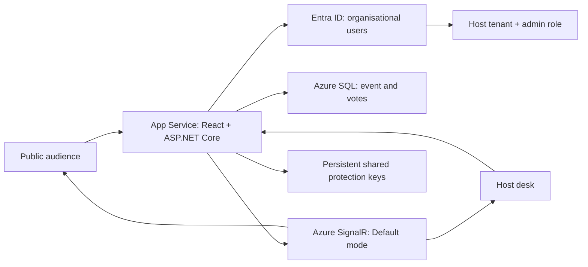

# Copilot Fireside Chat · Christmas edition

A runnable React + ASP.NET Core application for a live Christmas panel. The audience
sets a display name to view without signing in. **Upvoting requires a work or school
Microsoft Entra account from any organisation**; the host desk requires the host
tenant and an explicit application role. Designed for **Azure App Service**, not
Static Web Apps.

**No Azure resources, Entra applications, infrastructure templates or deployment
workflows have been created.** Scaffolding and provisioning require separate approval.

## What it does

- Public audience page focused on the current discussion, with a direct vote
  action. Questions, favourites, answered questions and panellist bios sit in
  secondary expandable sections. If no discussion is selected, a waiting state
  appears rather than choosing a question on the host's behalf.
- Name-to-view participation with a protected HTTP-only display-name cookie.
  Names are not authentication and are not public. Viewing and SignalR remain
  anonymous; the voting API requires a validated organisational Entra identity.
- One vote per question per Entra tenant/user object identity, enforced by a
  database primary key using a stable pseudonymous hash of `tid` + `oid`. Clearing
  cookies, changing display names or signing into another browser does not reset
  that identity's vote. This is **not one vote per verified human**: a person may
  hold multiple organisational accounts or guest identities.
- Host desk at `/admin`: create, edit, order, publish, hide and delete panellists and
  questions; select the current discussion; mark questions answered; pause voting;
  edit the event title and subtitle. New content is hidden by default.
- Server-enforced host tenant plus admin role, CSRF protection, secure production cookies, same-origin
  APIs, validated input, rate-limited participation and revision-checked host edits.
- SignalR invalidations after committed writes; clients refetch a filtered snapshot
  on notification, reconnect, tab wake-up and every 15 seconds. Hidden material never
  leaves the admin API. The public hub has no client-callable publishing methods.
- SQL transactions and a composite vote key prevent duplicate concurrent votes.
  Stale host edits and database contention return a visible retry/conflict response.
- Production starts only with real Entra, SQL and Azure SignalR configuration.
  There is no production anonymous-admin shortcut.

## Run the local sample event

Prerequisites: **.NET 10 SDK**, **Node.js 22.12+** and npm. No Azure login is needed.
Commands below run from the repository root in PowerShell.

```powershell
npm ci --prefix .\client
npm run build --prefix .\client
dotnet run --project .\server\Fireside.csproj --launch-profile Demo -- --initialize-database --seed-demo
dotnet run --project .\server\Fireside.csproj --launch-profile Demo
```

Open http://127.0.0.1:5180 and http://127.0.0.1:5180/admin in separate browser
contexts. Set an audience name, then choose **Sign in as demo voter** to simulate
Entra voting. Viewing without that step works; upvotes remain disabled. Choose
**Enter demo host desk** on the admin page. Publish a question, discuss it and vote
from the audience window. Demo voter sign-in represents one fixed sample identity
across browsers, not a real Microsoft account.

The explicit `Demo` launch profile sets Development, uses local SQLite and enables
the labelled local host/voter shortcuts. Demo startup is rejected outside Development or
when the Azure App Service `WEBSITE_INSTANCE_ID` environment variable is present.
The sample speakers are fictional placeholders, not confirmed guests. Samples are
seeded only with `--seed-demo` into an empty database. Re-running initialization does
not overwrite an existing event.

Local data and protection keys live under `server\.data` and are git-ignored.
Don't delete that directory if you want to retain cookies, vote records and content.
An event without sample data can be initialized with `--initialize-database` alone.

For frontend hot reload, leave the ASP.NET server running and, in another terminal:

```powershell
npm run dev --prefix .\client
```

Vite proxies `/api`, `/auth` and `/live` to port 5180. Use the same browser origin
throughout a session. Use the built application, not Vite, for real Entra sign-in.

## Validate

```powershell
dotnet test .\tests\Fireside.Tests.csproj
npm test --prefix .\client
npm run build --prefix .\client
# With the local Demo server running:
npm exec --prefix .\client -- playwright install chromium
npm run test:e2e --prefix .\client
# Produces one deployable application, including the React build:
dotnet publish .\server\Fireside.csproj -c Release -o .\server\bin\publish
```

Server integration tests exercise host-tenant/role restrictions, anonymous/forged
participant identities, malformed/personal identity rejection, cross-tenant voting,
CSRF enforcement, concurrent duplicate votes, cross-browser uniqueness, renaming, hidden content,
revision conflicts, voting eligibility, deletion cascades, live hub invalidation,
and production demo rejection. React tests cover vote eligibility and safe text
rendering. Desktop and mobile Playwright scenarios use independent audience/host
contexts to exercise public reading, explicit voter sign-in, moderation, voting,
cross-browser uniqueness, voter denial at the host desk and reconnect recovery.
Browser tests add and clean up their own clearly named sample content; run them
against a development event only.

## Proposed Azure architecture



React is served by the same ASP.NET application as the API and hub, avoiding
cross-origin cookie and authentication configuration. Azure SignalR fans out a
data-free change event; browsers then fetch their own permitted projection.
SQL Server/Azure SQL is mandatory outside local development/tests: local SQLite
must not be put on App Service ephemeral storage or used for scaled-out production.

The Web application registration must support **Accounts in any organisational
directory (multitenant)**, not personal Microsoft accounts. Audience OIDC uses the
`organizations` v2 endpoint with Microsoft's `AadIssuerValidator`, signature,
audience and lifetime validation, plus valid tenant/object ID checks. Personal
Microsoft consumer identities are rejected. There is no `ValidateIssuer=false`
shortcut. Tenant consent policies still apply: an external organisation may require
administrator consent before its users can sign in.

Voting accepts organisational identities from any Entra tenant. Host management
additionally requires the configured administrative tenant **and** `Fireside.Admin`.
An external tenant assigning that role to its own user cannot grant host access.
Host-desk sign-in uses a separate, tenant-specific OIDC scheme so guest hosts
authenticate in the host directory, not accidentally in their home directory.
External hosts can be invited as B2B guests in the host tenant and assigned the role
there. The application stores no email addresses or raw Entra IDs in vote records;
the stable hash remains pseudonymous personal data requiring an event retention policy.

## Real Entra voter and administrator sign-in

After approval, an Entra administrator must:

1. Select the administrative tenant and create a **multitenant Web application**
   registration, supported account type **Accounts in any organisational directory**.
   Register `https://<event-host>/signin-oidc` and
   `https://<event-host>/signin-oidc-admin` as Web redirect URIs, and
   `https://<event-host>/signout-callback-oidc` as a signed-out callback.
   For local Entra testing, also register `https://localhost:7180/signin-oidc`
   and `https://localhost:7180/signin-oidc-admin`.
2. Add an app role with **value `Fireside.Admin`**, allowed member type **Users/Groups**,
   enabled. Assign only the intended host users/groups to it in Enterprise
   applications in the host tenant. Do not require enterprise-application assignment
   for all users if that would prevent the intended unassigned audience voters.
   Merely signing in or being an Entra directory administrator does not grant access.
3. Configure the tenant ID, client ID and a client secret outside source control.
   The confidential server performs OIDC authorization code + PKCE; the browser
   receives only an encrypted application cookie, not tokens or the client secret.
   The standard `openid` / `profile` scopes are sufficient: this application does
   not call Microsoft Graph and needs no directory-wide API permissions.

For local real-auth testing, use environment variables (or your secret manager) and
the `Entra` launch profile:

```powershell
# Set AzureAd__TenantId, AzureAd__ClientId and AzureAd__ClientSecret securely first.
dotnet dev-certs https --trust
dotnet run --project .\server\Fireside.csproj --launch-profile Entra -- --initialize-database
dotnet run --project .\server\Fireside.csproj --launch-profile Entra
```

No values for a real tenant or secret are present in this repository. Never paste
secrets into commands that will be committed, support transcripts or browser code.
Authentication sessions expire after two hours; removing a host role takes effect on the next
sign-in/expiry, not by immediately revoking an already-issued app cookie.

## App Service configuration handoff — not deployment authorization

Agree the subscription, region, resource names, capacity, budget, domain and admin
tenant before any infrastructure scaffold. Approve a separate deployment step before
creating or modifying billable resources.

| App setting | Required value / decision |
|---|---|
| `ASPNETCORE_ENVIRONMENT` | `Production` |
| `Demo__Enabled` | `false` (never deploy the Demo launch profile) |
| `AllowedHosts` | Exact public App Service/custom host names, semicolon-separated |
| `Database__Provider` | `SqlServer` |
| `ConnectionStrings__Fireside` | Azure SQL connection string; prefer App Service managed identity with least-privilege DB permissions and encrypted transport |
| `ConnectionStrings__AzureSignalR` | Azure SignalR connection string, kept in App Service/Key Vault configuration; service **Default** mode, never Serverless |
| `AzureAd__TenantId` | Administrative directory tenant GUID |
| `AzureAd__ClientId` | Web application client GUID |
| `AzureAd__ClientSecret` | Key Vault reference/App Service secret setting, with an agreed rotation owner |
| `DataProtection__KeyPath` | Persistent shared writable path outside the deployment package (Linux App Service: `/home/fireside-keys`; Windows: a dedicated directory under `D:\home`) |
| `ASPNETCORE_FORWARDEDHEADERS_ENABLED` | `true` behind the trusted App Service ingress only; leave unset when directly hosting Kestrel |

Use the App Service .NET 10 runtime, HTTPS Only, Always On and WebSockets. Linux
startup command: `dotnet Fireside.dll`. Run the published output from its directory.
Keep app-level anonymous access enabled: the application itself protects admins,
while audience pages and SignalR negotiation must remain public. Don't enable
platform-wide mandatory Easy Auth, which would block the requested public audience.

App Service's ingress must be the only path to Kestrel and must sanitize forwarded
headers. The forwarded-header setting is appropriate for that controlled topology,
not an untrusted general-purpose reverse proxy. Verify HTTPS callback URLs and secure
cookies through the real ingress before opening the event.

Persist and restrict access to the Data Protection key ring: losing it invalidates
admin and participant cookies. It must be shared by all instances serving the same
event, and treated as secret key material. App Service storage encryption/permissions
protect the baseline file-based key ring; use a Blob/Key Vault-protected key ring if
the deployment's security policy requires application-level key encryption. Plan
slot/key sharing before using deployment slots. Back up SQL independently of the app.

### Database initialization and operations

After resource/deployment approvals, provide configuration and run the published
application with `--initialize-database` once against a **new, empty database**:

```powershell
dotnet .\Fireside.dll --initialize-database
```

This explicitly creates the initial schema and an empty event, without sample
speakers or questions, then exits. Use an operator identity with schema creation
permissions for this step; use a separate least-privilege read/write app identity
at runtime. Database creation is not automatically performed during normal startup.
The initializer uses EF `EnsureCreated` for this first schema: it is **not** a
schema upgrade system. Future model changes need reviewed migrations and a backup/
restore plan; do not rerun it as an upgrade mechanism.

Before going live, verify real organisational sign-in from both the host tenant and
an external tenant, personal-account rejection, external-tenant admin-role denial,
host-tenant role assignment, Azure SQL connectivity and
transactions, Azure SignalR fan-out across two app instances, TLS forwarding,
shared cookie keys and restore procedures in the approved environment. These
cloud integrations are implemented but cannot be end-to-end certified without
the resources/credentials and provisioning approval.

Operational notes:

- `/health` is liveness, not a database/SignalR dependency readiness test.
- Participation limits are per IP per app instance (60 writes/minute). Shared
  venue networks may need an agreed limit; abuse-resistant cross-instance quotas
  or verified-human voting require a separate design.
- Successful commits remain successful if notification delivery fails; the server
  logs the failure and client reconciliation repairs missed invalidations.
- No display names, raw Entra identifiers or Entra tokens are stored in the event/vote
  tables; vote keys are stable pseudonymous hashes, not anonymous identifiers. Publish an
  event contact and retention policy on `/privacy` before live use; the current text
  explicitly identifies that operator-owned policy as still to be supplied.
- Question deletion removes its votes. There is deliberately no unauthenticated
  public question submission endpoint.

## Branding

The public [Copilot Connection reference](https://github.com/Copilot-Connection/CCWeb2)
links to the [actual Copilot Fireside Chat site](https://copilotfireside.chat/).
This app reuses its existing fireplace brand photograph with an explicit caption,
not as a claim about confirmed Christmas panellists. The audience defaults to the
reference site's charcoal-and-gold direction, with self-hosted Krona One display
type and a newly drawn, restrained network motif. The simple flame icon is **not claimed to be
an official logo**. No separate Fireside logo asset was identified (the small mark
on the existing site is the Microsoft Copilot product logo). Asset provenance is
recorded alongside the image in `client/public/branding/README.md`.
